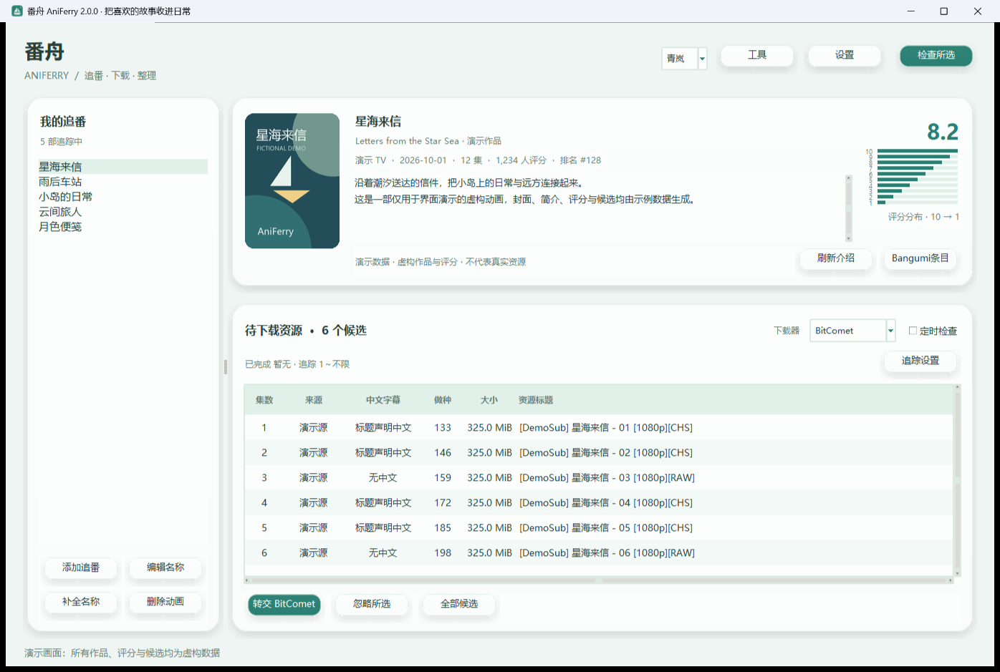

<p align="center"></p>

# 番舟 · AniFerry

**把新番更新送到下载器，让追番与整理更顺手。**

[](https://github.com/YushiroYukina/aniferry/actions/workflows/windows-build.yml)

番舟是一款 Windows 本地追番桌面工具：追踪动画更新、从多个来源整理 BT 候选、查看 Bangumi 资料，并在人工确认后把种子交给下载器。原名“追番信箱”，当前版本 **1.10.0**。

## 主要功能

| 功能 | 说明 |
| --- | --- |
| 多名称、多源检索 | Nyaa按中文、日文、罗马音、英文分别搜索，结合AnimeGarden、蜜柑、動漫花園补充；同infohash去重，优先推荐ANI，否则每集最多3个候选 |
| 名称补全与连续添加 | 选择Bangumi作品后补全可获取的中日文、罗马音和英文名；保存后可立即继续录入，不等待资源搜索 |
| 作品资料卡 | 封面、简介、评分、评分人数、排名与评分分布；首次预抓取、每日补充和5小时详情间隔缓存 |
| 多下载器转交 | BitComet、qBittorrent、aria2、Motrix 1.x、迅雷；核对任务哈希与目录后确认接收 |
| 按集追踪 | 每部独立设置集数范围；完整下载第n集后，弃置小于n−1的未转交候选 |
| 批量整理 | 动画与候选多选、批量删除/忽略，一键清除当前动画的待核对候选并记住清理结果 |
| 后续字幕工作流 | 标记标题声明中文、无中文、未知；导出已接收资源的字幕处理队列，不内置AI字幕生成 |
| 六套主题 | 青岚、暮紫、樱雾、暖杏、晴空、深海；圆角卡片、柔和光影，支持紧凑窗口 |

## 界面预览

下图使用**虚构作品、评分和候选数据**，仅展示界面，不代表真实资源或抓取结果。



[查看六套主题](docs/images/themes.png)

## 适用范围

- 面向使用Windows x64和本地下载器、希望按集整理追番的个人用户。当前实测环境为Windows 11 x64、Python 3.12；其他系统尚未验证。
- 需要能够访问所选RSS/API来源；程序运行期间才定时检索和监测，不是Windows后台服务。
- 下载器需自行安装、启用对应接口并配置；资源需要人工确认后转交。迅雷还需在新建任务窗口确认下载目录。
- 不包含动画文件、播放器、云下载服务、AI翻译或字幕生成模型；仅用于处理有权获取的内容。

## 快速开始

### 普通用户

到本仓库 [Releases](https://github.com/YushiroYukina/aniferry/releases) 下载 `AniFerry-1.10.0-Windows-x64.zip`，解压整个目录后双击 `AniFerry-1.10.0.exe`。无需另装Python，须保留同目录 `_internal/`。

1. 打开“设置”，选择自己的下载目录，配置下载器并测试连接。为兼容旧版，未设置时默认仍为 `E:\动画\202610\追番`；新用户应按实际盘符修改。
2. 点击“添加追番”，查找并选用正确的Bangumi作品与季度，可连续添加多部。
3. 查看候选并核对片名、集数、字幕标记，单选资源后点击“转交”。

“待接收”表示已经提交但尚未核对成功；“已转交”表示任务哈希和目录已匹配，**不等于已下载完成**。

详细设置、批量清理、资料刷新与故障排查见[使用指南](docs/USAGE.md)。

### 从源码运行

使用包含Tcl/Tk的Windows Python 3.12：

```powershell
python -m venv .venv
.\.venv\Scripts\python.exe -m pip install -r requirements.txt
.\.venv\Scripts\python.exe app.py
```

## 当前验证与限制

- 核心、Tk交互、资料缓存与下载器协议有55项本地回归测试；Windows打包程序通过启动检查。详细范围见[验证说明](docs/VALIDATION.md)。
- qBittorrent、aria2和Motrix主要通过本地HTTP模拟服务验证协议；BitComet、迅雷的本机任务记录读取曾验证。新接入下载器尚无新任务完整下载验收，不把“启动成功”或“接口模拟通过”当作真实下载成功。
- 搜索来源有近期结果数量、网络访问和命名差异限制；误匹配过滤不能替代人工核对。
- 字幕标记根据资源标题判断，没有检查实际媒体字幕轨道。只下载种子内部分文件不会自动认定整集完成。
- Windows发行包尚未代码签名；[GitHub Actions](https://github.com/YushiroYukina/aniferry/actions/runs/39095487280)已通过云端测试、Windows打包和启动检查。

## 数据与升级

本地数据继续保存在 `%LOCALAPPDATA%\AnimeTracker`，兼容原“追番信箱”的追番、设置和转交记录。升级前关闭旧版；备份时关闭程序后复制整个数据目录。密码和RPC密钥使用当前Windows用户加密保存，换Windows用户后须重新填写。

## 开发与打包

```powershell
.\.venv\Scripts\python.exe -m pip install -r requirements-build.txt
.\build.ps1 -Python .\.venv\Scripts\python.exe
.\.venv\Scripts\python.exe tools\prepare_release.py
```

构建输出在 `dist/`。公开源码整理工具通过允许清单生成独立上传目录及源码ZIP；开发数据、种子、缓存、日志和本机验证笔记不随源码发布。

[贡献说明](CONTRIBUTING.md) · [GitHub发布指南](docs/PUBLISHING.md) · [更新记录](CHANGELOG.md) · [问题与敏感信息](SECURITY.md)

## 许可证与来源

项目源码采用[MIT许可证](LICENSE)，第三方组件见[许可说明](THIRD_PARTY_NOTICES.md)。演示图和标识由项目绘制，外部服务的内容与封面保留各自权利。

外部接口：[Bangumi](https://bangumi.github.io/api/)、[AniList](https://docs.anilist.co/)、[Jikan](https://docs.api.jikan.moe/)、[Nyaa RSS](https://github.com/nyaadevs/nyaa/blob/master/nyaa/templates/rss.xml)、[AnimeGarden](https://github.com/yjl9903/AnimeGarden)、[蜜柑](https://mikanani.me/)、[動漫花園](https://share.dmhy.org/)。
